In August of last year I wrote a post about building this blog in 90 minutes with 233 lines of code. I was proud of everything it left out. It used system fonts only, because "your OS spent millions on typography," and it shipped zero bytes of JavaScript.

What you're reading now is a little under 28,000 lines of Rust. The letters are set in fonts made by simulating a dip pen writing each one. A 400 KB WebAssembly program draws the sheet they sit on, and if your screen is wide enough it streams in pictures of a mahogany desk that was modeled starting from the tree it was cut from. I've started thinking of it as a rendering engine that happens to have some text in it.

## How it started

On Tuesday afternoon I typed "i want to redo my blog. i want it to be beautiful and ornate." The first plan used Three.js and I killed it within five minutes, because I didn't want janky 3D. What I did want took a few more messages to put into words, and the one that stuck was "something that doesn't feel digital."

I had a reference. Last week I built a map of the Sword Coast for running D&D, and everything on it is drawn by a simulated dip pen, in Rust compiled to WebAssembly and drawn straight to WebGL with no engine in between. The ink runs dry and gets re-dipped. Pigment pools and granulates. I loved how it came out, so the blog started as a fork of the map's pen.

I didn't write a line of the Rust. Claude Code ran the project and Fable agents did the building, one on the page and the ink and another on the desk. They'd report back with measurements, like the brightest pixel on the desk dropping from 228 to 127, and I'd look and say things like "tine tracks are a bit overdramatic, walk them back somewhat." At one point they kept opening browser windows over whatever I was doing to take screenshots, and I had to type "you keep taking over my screen please stop." About thirty hours after the first message, with a night's sleep in the middle, it was live.

## The pen

Most of what the pen does is go wrong the way a real pen goes wrong. Pressure spreads the tines and the line swells. Every stroke drains the reservoir, so the line greys and starts skipping over the tooth of the sheet, and eventually the film of ink between the tines breaks and the stroke splits into two rails. Then the hand goes back to the well and the next stroke lands dark.

<figure class="pl two" id="plate-i" data-plate="I">
<a href="media/loupe-words-full.jpg" data-w="2560" data-h="1280">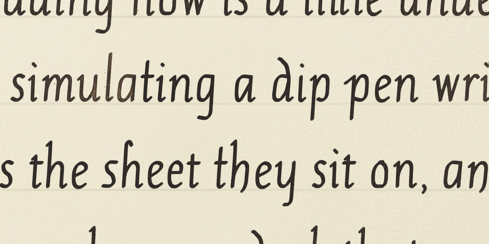</a><a href="media/loupe-dry-full.jpg" data-w="2560" data-h="1280">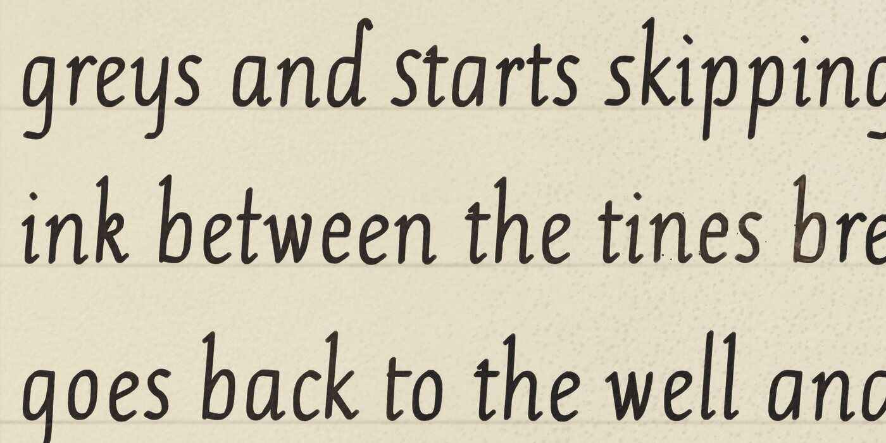</a>
</figure>

[Plate I.](#plate-i) *Body text at about thirteen times, through the page's own loupe. The grain of the vellum and its ruled lines show through, and no two strokes hold the same amount of ink.*

The hand trembles. Short strokes bow along the arc of the wrist, and sometimes it hesitates and leaves a dot.

The ink keeps moving after the nib lifts. It creeps a little way along the fibres of the sheet, and as a stroke dries the pigment migrates to its edge like a coffee ring. The desk slopes toward the scribe, so the lower edge of each stroke collects more than the upper one. Iron-gall ink is partly a dye, so it stains the sheet a hair past where the pen went.

<figure class="pl" id="plate-ii" data-plate="II">
<a href="media/loupe-title-full.jpg" data-w="1920" data-h="1280">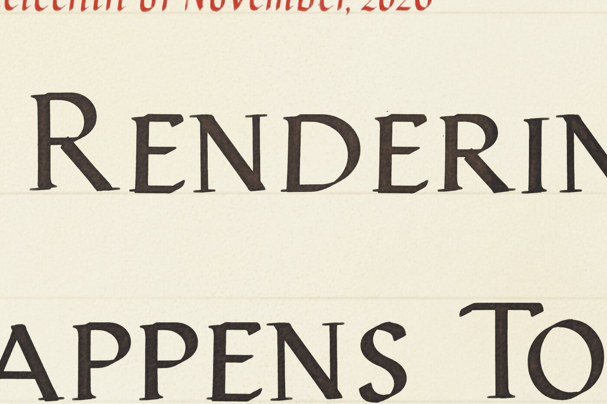</a>
</figure>

[Plate II.](#plate-ii) *The title at about ten times. The ink is darkest along the edges of each stroke, where the drying pigment gathered.*

The sheet is calfskin vellum, ruled in faint lines with prick marks down the margin where a scribe would have measured them out. The pen asks the sheet what it's writing on at every point, so a dry stroke breaks on ridges that are really in that sheet, and wet ink gathers in its real hollows.

My main note on all of this was "the ink shouldn't run out QUITE so fast." The first version was re-dipping in the middle of words.

## The fonts

The map's lettering has no font files. Each letter is a skeleton path with a few strokes of a broad-edge nib along it, so the thick and thin parts come from the angle of the pen instead of from an outline someone drew. For the blog, those strokes get exported as real font files, because the browser needs something it can lay out.

A scribe doesn't write a letter the same way twice in a row, so the fonts carry several forms of most letters and choose between them by looking back at up to eight letters before. The map never needed a dollar sign or a percent sign. The blog did, so the scribe learned two new letters.

<figure class="pl" id="plate-iii" data-plate="III">
<a href="media/loupe-percent-full.jpg" data-w="2560" data-h="1280">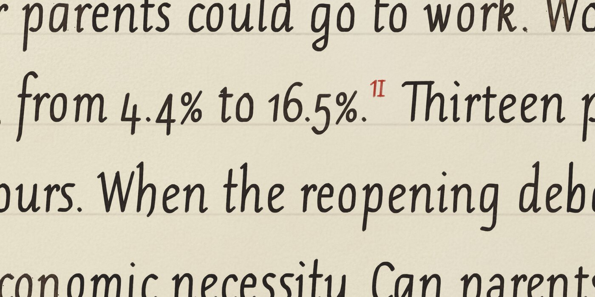</a>
</figure>

[Plate III.](#plate-iii) *One of the scribe's two new letters, at work in an older post.*

## The invisible text

The page is real HTML. You can select and search it, a screen reader can read it, and it prints. Turn JavaScript off and you get a plain page of the same text in the same fonts.

<figure class="pl" id="plate-iv" data-plate="IV">
<a href="media/nojs-full.jpg" data-w="2880" data-h="1800">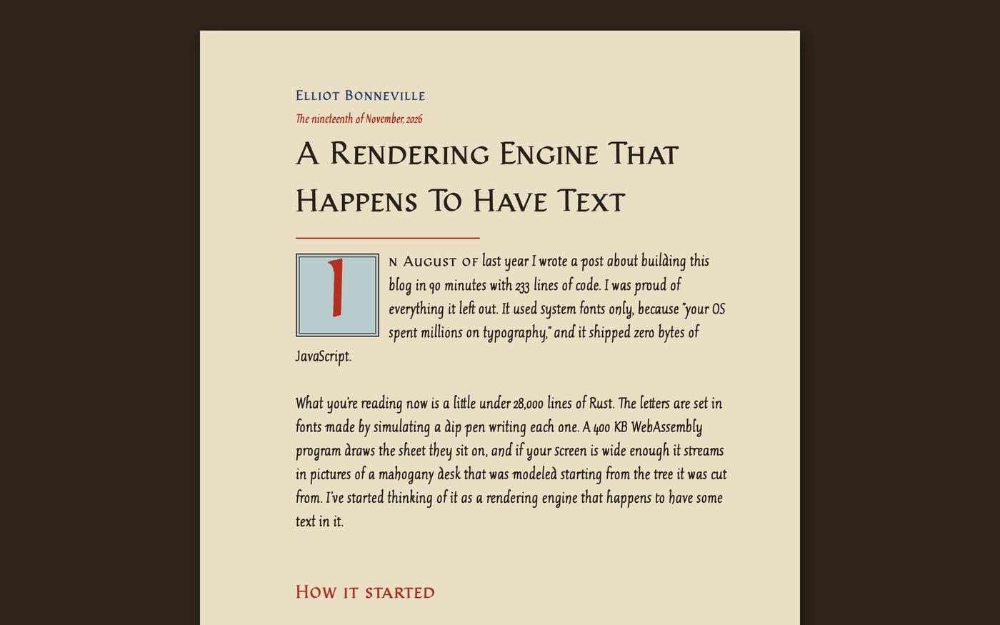</a>
</figure>

[Plate IV.](#plate-iv) *With JavaScript off: the same words in the same fonts, on a plain sheet.*

When the program runs, it asks the browser where it put every word. Then it draws each word again, in the same font in the same spot, into a texture that a shader turns into ink on vellum. That texture also records how much ink the pen had left at each word, so the load falls off across a run of words and comes back at a dip. Once that's done, the browser's own text is made transparent.

So when you highlight a sentence here, you're selecting invisible words that lie exactly under the ink. The browser still does all the work of laying out the text. It just doesn't get to show it to you.

<figure class="pl two" id="plate-v" data-plate="V">
<a href="media/select-full.jpg" data-w="1520" data-h="856">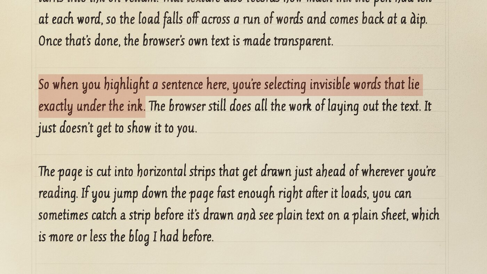</a><a href="media/select-under-full.jpg" data-w="1520" data-h="856">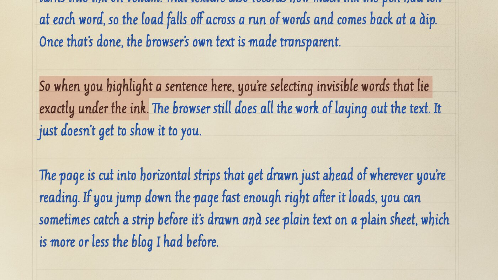</a>
</figure>

[Plate V.](#plate-v) *A sentence selected, and the same passage with the browser's own transparent text forced visible in blue.*

The page is cut into horizontal strips that get drawn just ahead of wherever you're reading. If you jump down the page fast enough right after it loads, you can sometimes catch a strip before it's drawn and see plain text on a plain sheet, which is more or less the blog I had before.

There's also a loupe. Press "Inspect the ink" at the top of a post and a round glass appears that you can drag over the page. It doesn't enlarge what's on the screen. The program draws the ink and vellum again at about three times the size, then bends them through a simulated 40 mm lens, an uncoated biconvex singlet in a real optical glass, traced at five wavelengths. That's why the letters fringe with colour toward the rim, the way they do under a cheap magnifier.

<figure class="pl" id="plate-vi" data-plate="VI">
<video src="media/loupe.mp4" poster="media/loupe-poster.jpg" width="1920" height="1080" controls playsinline muted loop preload="none" aria-label="The ink loupe moving over the head of this post"></video>
</figure>

[Plate VI.](#plate-vi) *The loupe moving over the title, the initial and the first lines.*

Most of what it shows was already on the page, just too small to see. A dry nib skipping over the vellum throws a few specks beside its heavier strokes, and each one is less than half a pixel across. Nobody reading at normal size will pick one out. I still think they matter. A page without them would look a little more printed, even if you couldn't say why.

<figure class="pl two" id="plate-vii" data-plate="VII">
<a href="media/loupe-javascript-full.jpg" data-w="1440" data-h="810">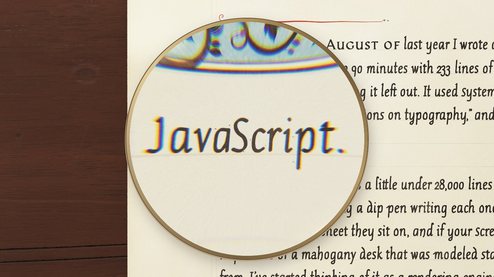</a>
</figure>

[Plate VII.](#plate-vii) *Specks from a dry nib beside “JavaScript.” at the end of the first paragraph, through the loupe and at sixteen times.*

## The desk

I asked for the wood to be "scarred and beat up, old, 1700s wood." The first attempt looked like a texture, so I asked for it to be modeled from physics the way the ink was, researched instead of hand-generated, and lit by a real lamp.

<figure class="pl" id="plate-viii" data-plate="VIII">
<a href="media/wide-desk-full.jpg" data-w="3840" data-h="2160">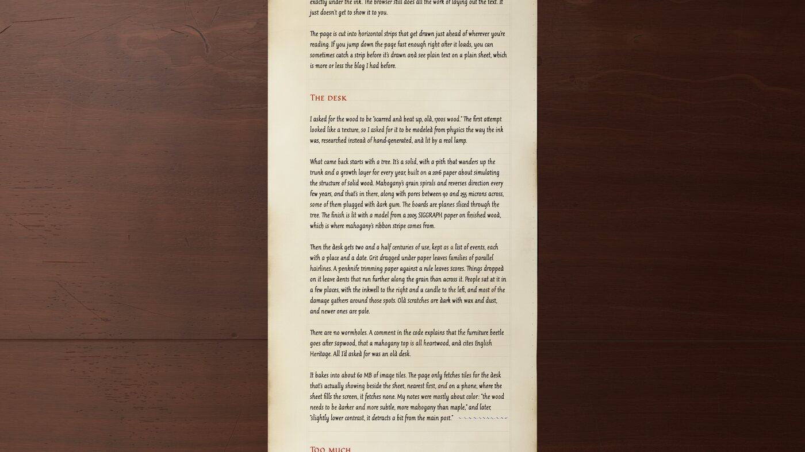</a>
</figure>

[Plate VIII.](#plate-viii) *The sheet on the desk in a wide window.*

What came back starts with a tree. It's a solid, with a pith that wanders up the trunk and a growth layer for every year, built on a 2016 paper about simulating the structure of solid wood. Mahogany's grain spirals and reverses direction every few years, and that's in there, along with pores between 90 and 255 microns across, some of them plugged with dark gum. The boards are planes sliced through the tree. The finish is lit with a model from a 2005 SIGGRAPH paper on finished wood, which is where mahogany's ribbon stripe comes from.

<figure class="pl two pl-wood" id="plate-ix" data-plate="IX">
<a href="media/wood-flat-full.jpg" data-w="1920" data-h="1080">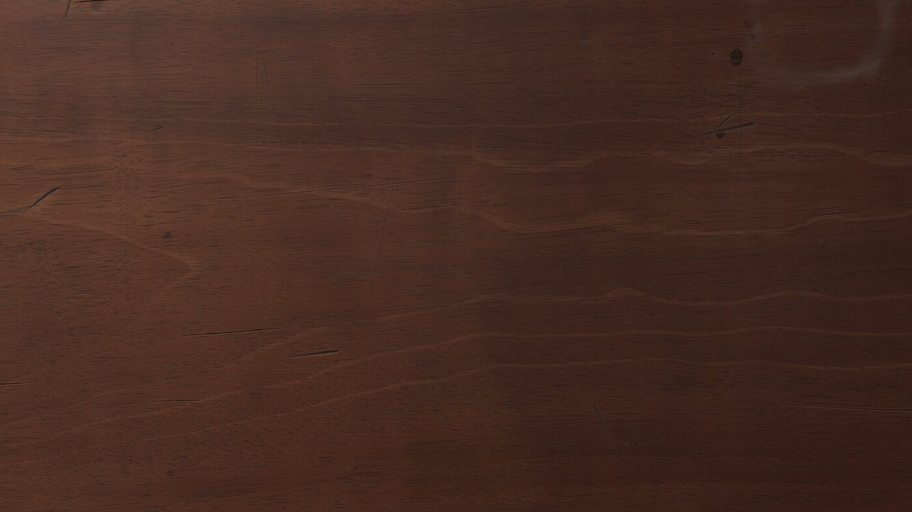</a><a href="media/wood-ribbon-full.jpg" data-w="1920" data-h="1080">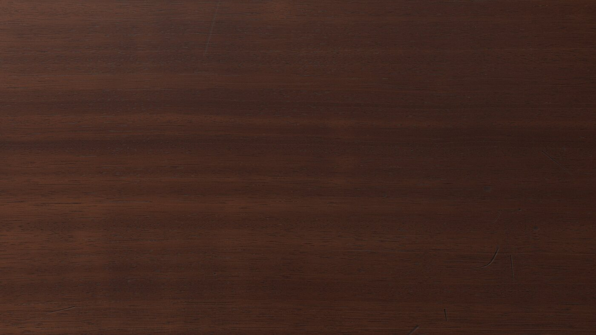</a>
</figure>

[Plate IX.](#plate-ix) *A flat-sawn board, where the face cuts across the growth rings, and a quartered one, where it runs along them and shows ribbon stripe.*

<figure class="pl pl-wood" id="plate-x" data-plate="X">
<a href="media/wood-pores-full.jpg" data-w="1920" data-h="1080">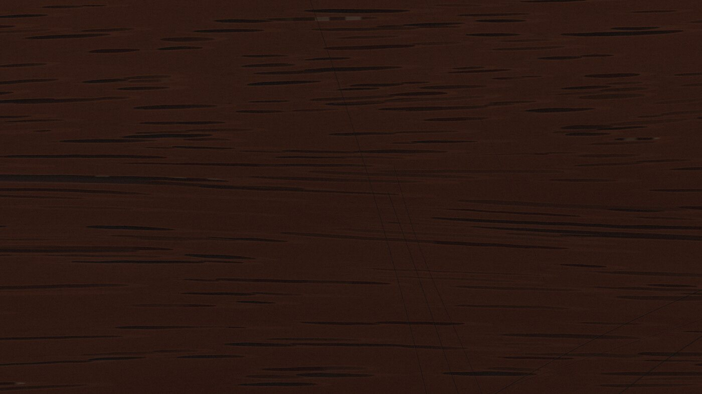</a>
</figure>

[Plate X.](#plate-x) *Mahogany at fourteen times: the open pores as grooves along the grain, some plugged with gum.*

<figure class="pl" id="plate-xi" data-plate="XI">
<video src="media/lamp.mp4" poster="media/lamp-poster.jpg" width="1920" height="1080" controls playsinline muted loop preload="none" aria-label="A lamp passing over a quartered mahogany board"></video>
</figure>

[Plate XI.](#plate-xi) *A lamp passing over a quartered board and back. The light and dark stripes trade places as it moves.*

Then the desk gets two and a half centuries of use, kept as a list of events, each with a place and a date. Grit dragged under paper leaves families of parallel hairlines. A penknife trimming paper against a rule leaves scores. Things dropped on it leave dents that run further along the grain than across it. People sat at it in a few places, with the inkwell to the right and a candle to the left, and most of the damage gathers around those spots. Old scratches are dark with wax and dust, and newer ones are pale.

<figure class="pl pl-wood" id="plate-xii" data-plate="XII">
<a href="media/wood-wear-full.jpg" data-w="1920" data-h="1080">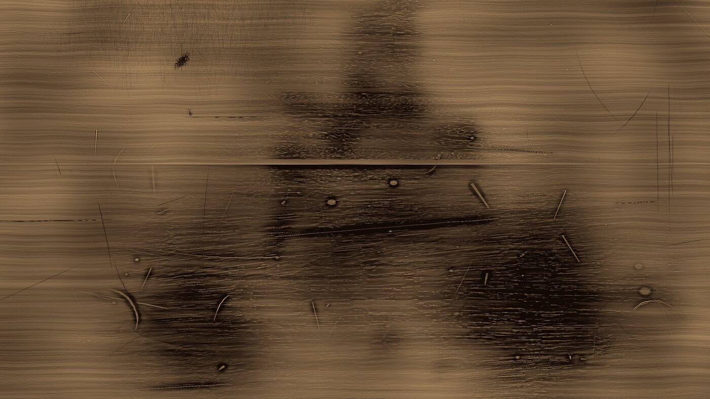</a>
</figure>

[Plate XII.](#plate-xii) *How much polish is left on one stretch of the desk: dark where forearms and sleeves wore it through, either side of where the sheet lay.*

<figure class="pl four pl-wood" id="plate-xiii" data-plate="XIII">
<a href="media/wood-scores-full.jpg" data-w="1920" data-h="1080">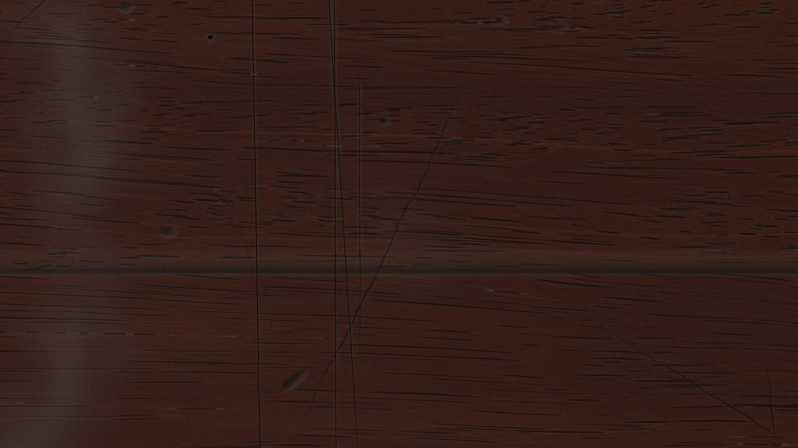</a><a href="media/wood-arc-full.jpg" data-w="1920" data-h="1080">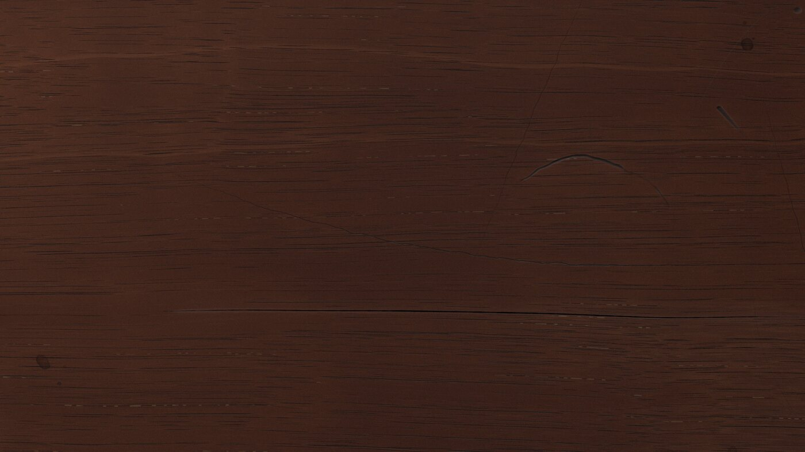</a><a href="media/wood-check-full.jpg" data-w="1920" data-h="1080">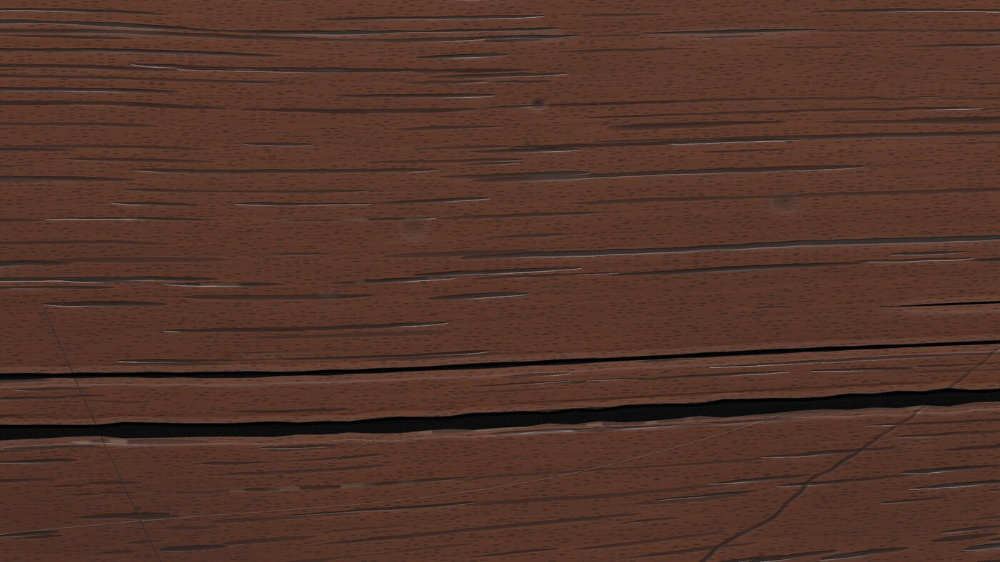</a><a href="media/wood-check-wide-full.jpg" data-w="1920" data-h="1080">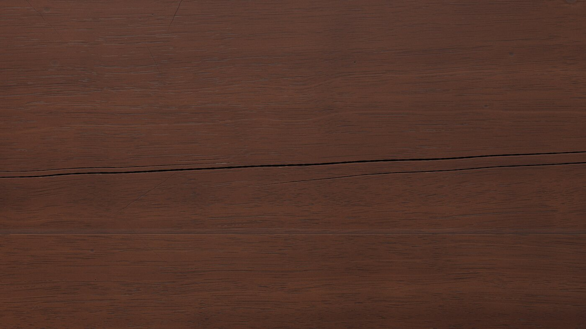</a>
</figure>

[Plate XIII.](#plate-xiii) *Knife scores running over a joint, the print of a candlestick's foot, and a check that opened along the grain as the wood dried, close up and whole.*

<figure class="pl four pl-wood" id="plate-xiv" data-plate="XIV">
<a href="media/wood-craze-full.jpg" data-w="1920" data-h="1080">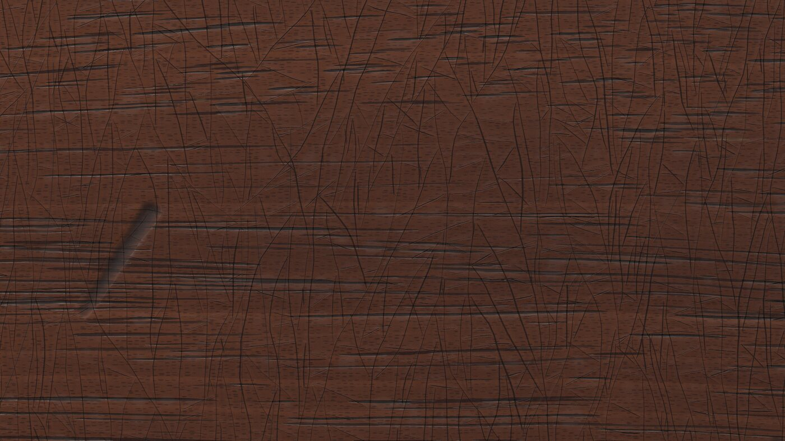</a><a href="media/wood-inkwell-full.jpg" data-w="1920" data-h="1080">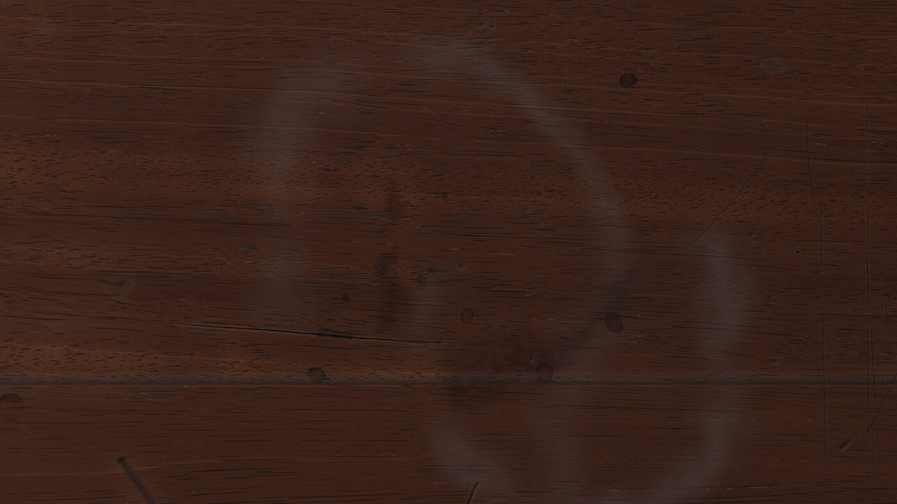</a><a href="media/wood-glass-full.jpg" data-w="1920" data-h="1080">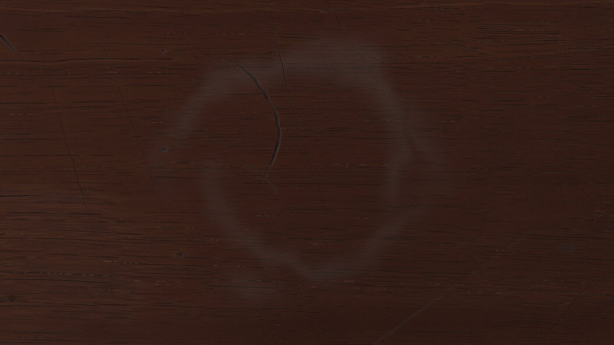</a>
</figure>

[Plate XIV.](#plate-xiv) *Crazed polish where a candle's warmth fell, a candle burn, the place an inkwell stood, and the white ring of a wet glass.*

There are no wormholes. A comment in the code explains that the furniture beetle goes after sapwood, that a mahogany top is all heartwood, and cites English Heritage. All I'd asked for was an old desk.

It bakes into about 60 MB of image tiles. The page only fetches tiles for the desk that's actually showing beside the sheet, nearest first, and on a phone, where the sheet fills the screen, it fetches none. My notes were mostly about color: "the wood needs to be darker and more subtle, more mahogany than maple," and later, "slightly lower contrast, it detracts a bit from the main post."

<figure class="pl four pl-wood" id="plate-xv" data-plate="XV">
<a href="media/layer-height-full.jpg" data-w="1920" data-h="1080">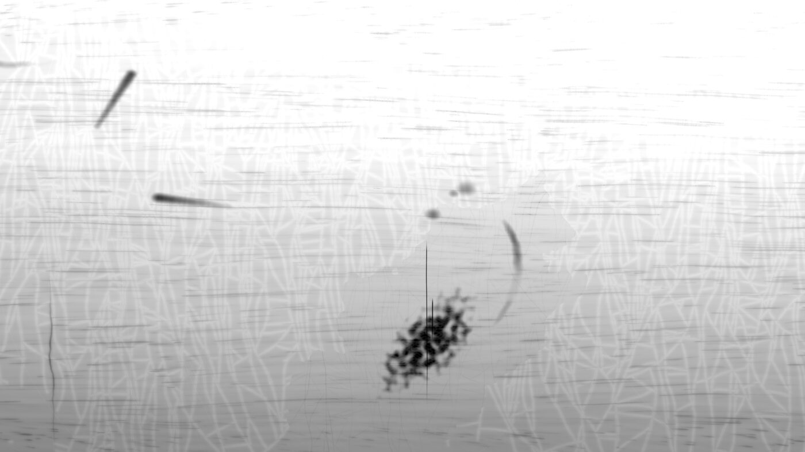</a><a href="media/layer-colour-full.jpg" data-w="1920" data-h="1080">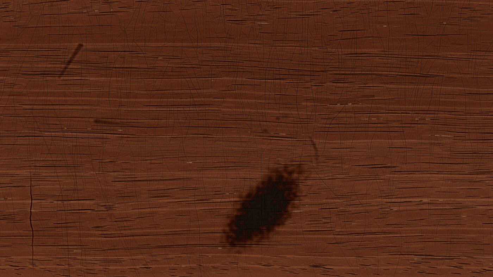</a><a href="media/layer-fibre-full.jpg" data-w="1920" data-h="1080">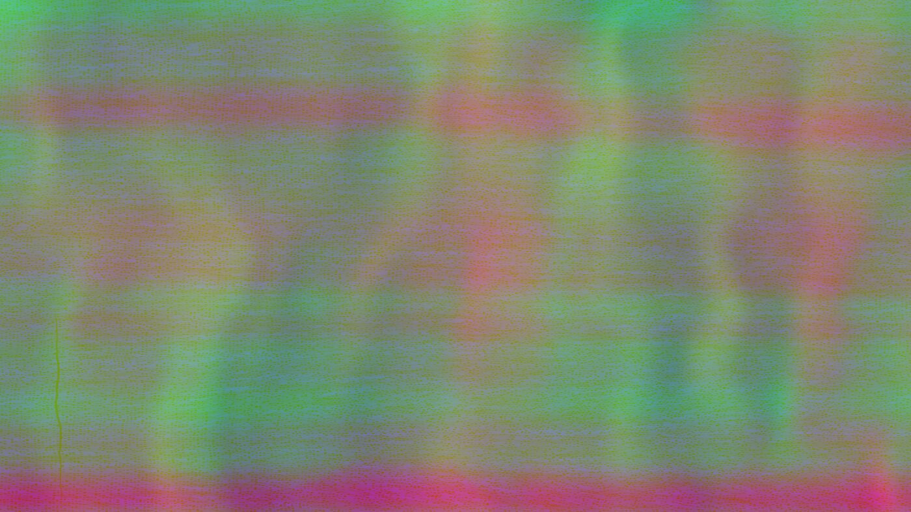</a><a href="media/layer-lit-full.jpg" data-w="1920" data-h="1080">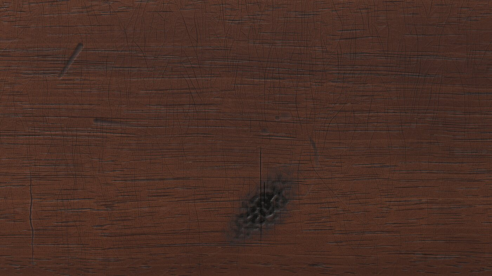</a>
</figure>

[Plate XV.](#plate-xv) *One patch by the candle, four ways: height, colour before light, the fibre's direction in false colour, and lit.*

One fun fact: this is the same mahogany that's on the desk in my virtual office, a room in orbit that I built to work in on my Vision Pro.

<figure class="pl" id="plate-xvi" data-plate="XVI">
<a href="media/office-full.jpg" data-w="1826" data-h="1136">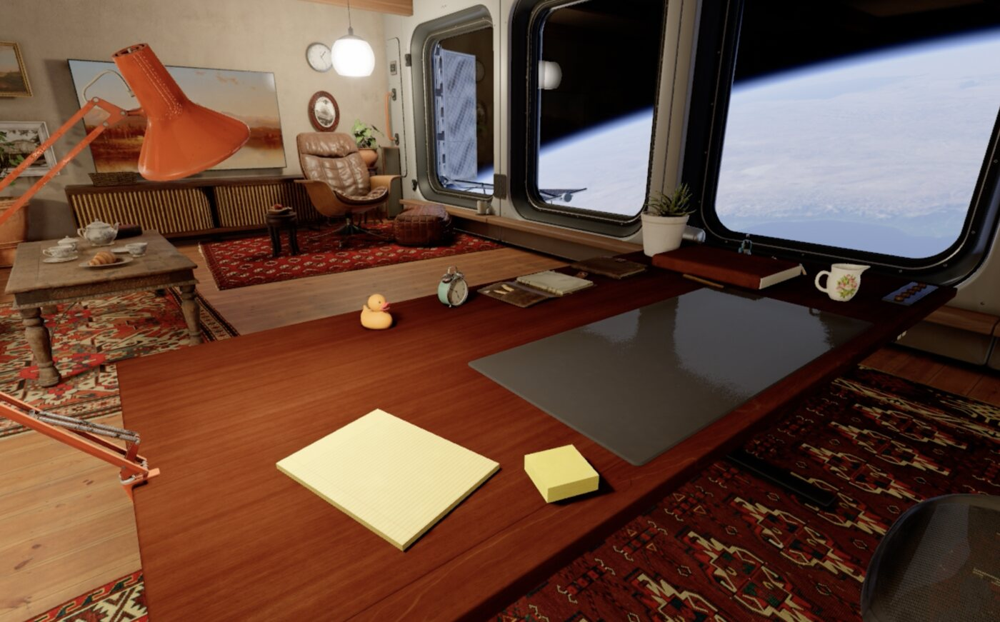</a>
</figure>

[Plate XVI.](#plate-xvi) *The office, with the same mahogany on the desk.*

## The years

All told, the desk's history is 20,782 marks and 219 spills. Each one is worked out from where it happened, what did it and how hard, and the wood is made by replaying them in order. About a quarter of them are under the sheet, where nobody will ever see them. The whole history takes about a tenth of a second to compute.

<figure class="pl" id="plate-xvii" data-plate="XVII">
<video src="media/history.mp4" poster="media/history-poster.jpg" width="1920" height="1080" controls playsinline muted loop preload="none" aria-label="The desk&#x27;s history accumulating year by year over one stretch of wood"></video>
</figure>

[Plate XVII.](#plate-xvii) *One stretch of the desk from 1763 to 2026. Each line is an event, drawn when it happened, before the stretch fades into the wood those events made.*

Nobody would build a prop this way by hand. Someone aging a table for a film set works from what old wood looks like, because working out every knock it took over 250 years and cutting each one in would take longer than the table is worth, and longer than most people would spend on anything. Throwing tokens at it gets you a kind of depth that's out of reach mostly because people don't live long enough to do it.

The person I think of who did something like this by hand is Tolkien, and it took him most of his life. In "On Fairy-Stories" he describes the writer making a Secondary World that your mind can enter and believe while you're inside it. "The moment disbelief arises, the spell is broken." What holds it together he called "the inner consistency of reality."

He went a long way to keep the spell from breaking. Inside *The Lord of the Rings*, the book isn't presented as a novel. It's a translation of the Red Book of Westmarch, a manuscript the hobbits kept, which didn't survive and is known only from copies with notes added by later hands. Tolkien is its translator and editor. An appendix explains how he rendered the hobbits' own language into English, and why their names come out the way they do.

When he changed how Bilbo came by the ring, he didn't call the first edition of *The Hobbit* a mistake. Inside the story, the old version became the one Bilbo told at first, a lie to strengthen his claim on the ring.

He made the objects too. For the Book of Mazarbul, the record the Fellowship finds slashed, burned and stained in Moria, he drew facsimile pages, burned their edges with his pipe, pierced holes along one side where the binding would have been stitched, and washed them with red paint for blood. He wanted them printed in the book, and the publisher left them out because they cost too much.

He thought the depth was a large part of why people loved the book, and wrote of "the glimpses of a large history in the background: an attraction like that of viewing far off an unvisited island." He spent nearly sixty years on the history behind it and died with *The Silmarillion* unfinished, and his son spent decades more editing what he left.

The desk is a tiny version of the same thing. Nobody will ever read its history, and a quarter of it lies under the sheet where it can't be seen at all, but it's still the reason the wood looks the way it does.

<figure class="pl pl-wood" id="plate-xviii" data-plate="XVIII">
<a href="media/history-2026-full.jpg" data-w="1920" data-h="1080">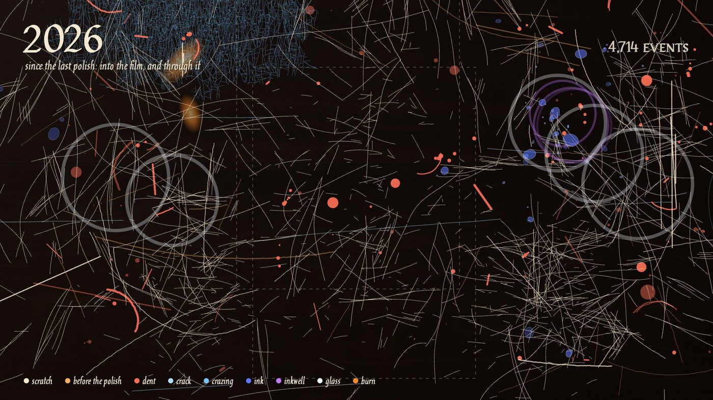</a>
</figure>

[Plate XVIII.](#plate-xviii) *Every event in that stretch at once.*

Proust wrote that the only true voyage of discovery "would be not to visit strange lands but to possess other eyes." Rendering with AI has done that for me. Having tried to recreate an old desk at this fidelity, I appreciate real wood, and the history in it, far more than I did before. I know now why old scratches are dark and new ones pale, why a dent runs out along the grain, why a glass leaves a white ring in the polish and spilt ink sinks into the pores.

Any desk that's been used for two and a half centuries carries all of that without anyone having worked it out. What I find beautiful about this kind of verisimilitude is how close it brings you to that depth, and how much more of it you notice afterward.

## Too much

The block at the top of each post is a vermilion letter on a pale blue ground, with a vine filling the space around it. Each scroll of the vine turns the opposite way from the one it springs from, the way real vines alternate, and where a stem would cross the letter the pen lifts, so it reads as passing behind.

<figure class="pl" id="plate-xix" data-plate="XIX">
<a href="media/loupe-initial-full.jpg" data-w="1920" data-h="1280">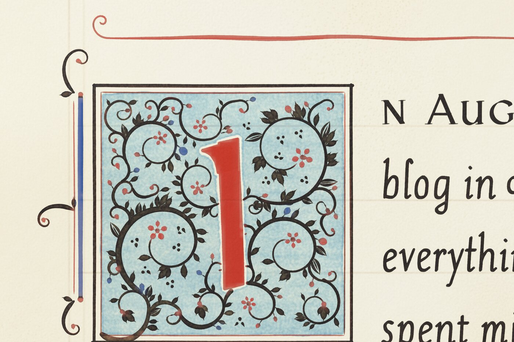</a>
</figure>

[Plate XIX.](#plate-xix) *The opening initial at eight times.*

For a while there was a lot more than that. Every section opened with a red or blue letter in a panel of filigree, tendrils ran down the margins, and short lines got little hand-drawn fillers. I told it the page was "a bit overly ornate in places."

What you see now is the moderate setting. Add `?orn=rich` to the address of any post to see the full version, or `?orn=plain` to strip it back. You can change the ink with `?ink=` and one of gall, sepia, walnut, murrey, moss or slate. Sepia is the default.

<figure class="pl three" id="plate-xx" data-plate="XX">
<a href="media/orn-plain-full.jpg" data-w="2560" data-h="1800">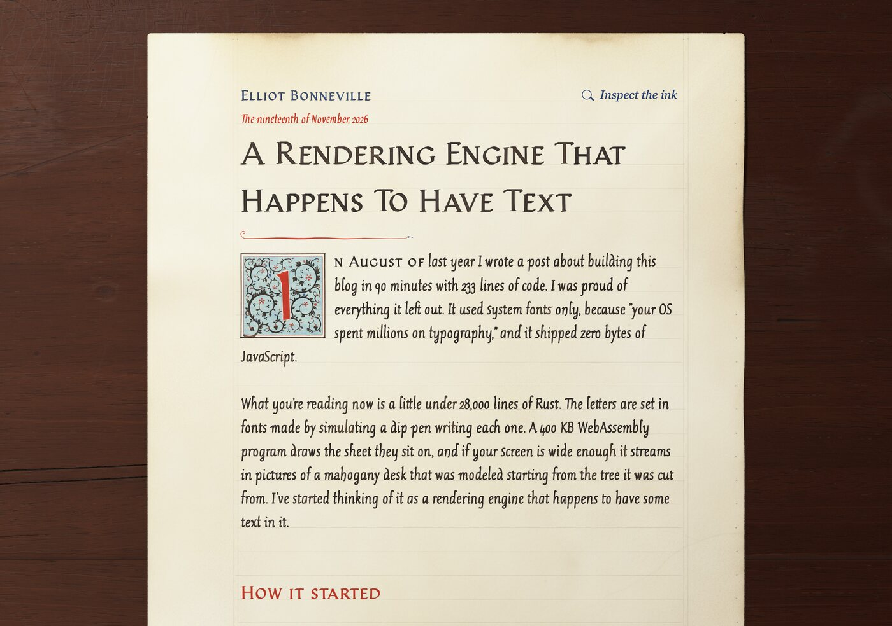</a><a href="media/orn-moderate-full.jpg" data-w="2560" data-h="1800">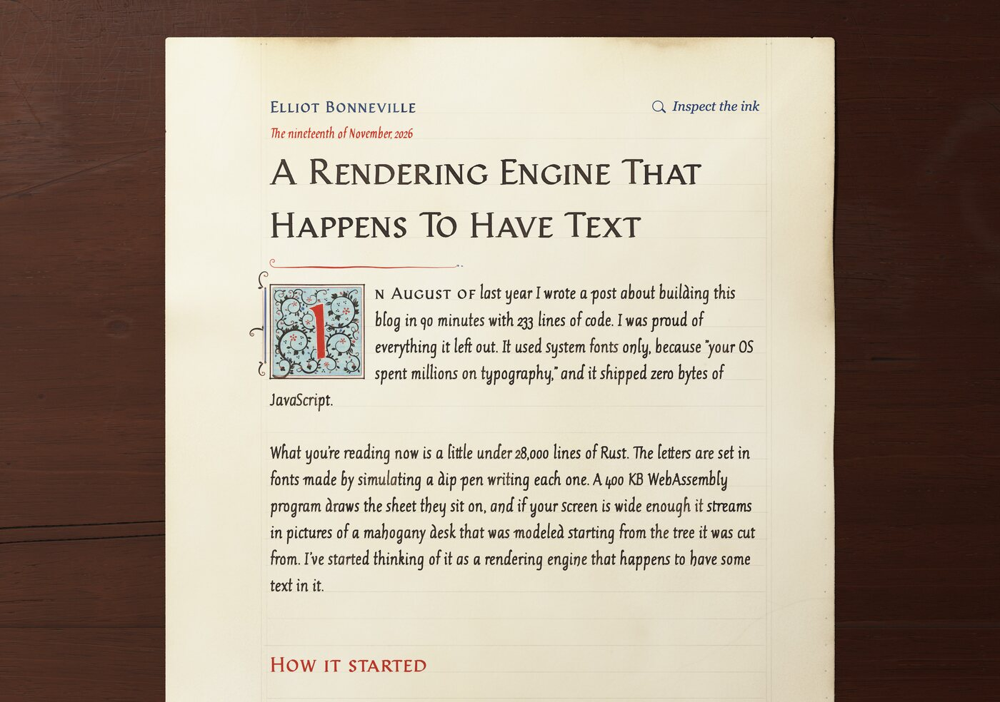</a>
</figure>

[Plate XX.](#plate-xx) *Plain, moderate and rich.*

## The coffer

In February I wrote a post in very bad fake Early Modern English about AI making personal websites strange again. One line in it: "That spare elegance was no aesthetick preference. 'Twas naught but the limitations of one's coffer." I didn't apply that to my own blog, even though I'd written a whole philosophy of minimalism for it six months before. I believed the philosophy. Reading it now, a fair amount of it was a budget.

Some of it held up. The site is still static files. The words are still text, and they still work with nothing running. What changed is that everything around the words got cheap enough to build.

Each post's sheet is aged by how long ago it was written. Older posts get more toning and more specks, on a curve that takes about ninety years to get two thirds of the way to ancient. The 90-minute post is a little over a year old, so you'd need a loupe to see it. The ages are recalculated whenever I rebuild the site, which means every new post makes the old ones a tiny bit older.

There's a [thread on X](https://x.com/elliotbnvl/status/2123474801918390417) with these clips and close-ups, and more of the wood.
